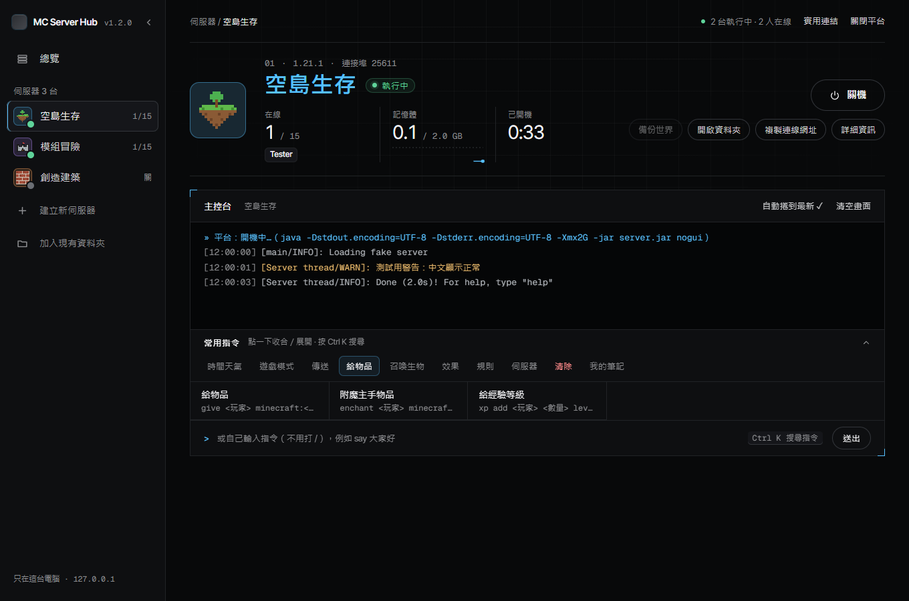

# MC Server Hub（MC 開服平台）

[](https://github.com/andytsui330/mc-server-hub/releases/latest/download/MCServerHub-Setup-Windows.exe)
[](https://github.com/andytsui330/mc-server-hub/releases/latest/download/MCServerHub-Mac.dmg)

**2.0.0 已正式發佈（2026-11-19）。** 點上方按鈕下載最新版；所有版本、檢查碼與更新說明見 [Releases](https://github.com/andytsui330/mc-server-hub/releases)。Windows 只提供安裝檔，Mac 只提供 DMG，不提供 2.0 可攜 ZIP。

在自己的電腦開 Minecraft Java 版伺服器：看誰在線、正常開關機、看主控台、下常用指令，以及管理玩家、模組與世界備份。介面使用繁體中文；此處說明以 2.0 為準。

| 平台 | 目前進度 |
| :-- | :-- |
| Windows x64 | 目標 Windows 10／11。正式安裝檔已實走下載、安裝、開啟，並驗過解除安裝與既有真服短測；缺少 WebView2 的乾淨電腦自動補裝尚未實測。 |
| Mac Intel | universal DMG，Intel／macOS 15.8.1 原生操作及真實建服通過；登入啟動與下載後首次開啟體驗仍未驗。Mac 尚未提供自動更新，新版請到 Releases 手動下載。 |
| Mac Apple 晶片 | DMG 內含 arm64 程式；Apple 晶片實機驗收暫緩，仍標示未驗，不能以 Intel 結果代替。 |

Mac 打包下限設為 macOS 11，這是建置設定，不代表所有 macOS 版本均已實測。完整範圍見 [第12步準備與待驗清單](docs/step12-readiness.md)。

> English — A local desktop manager for Minecraft: Java Edition servers. Tauri 2 + Rust + React; Traditional Chinese interface. Version 2.0.0 was released on 2026-11-19. The control interface uses internal desktop IPC, not a listening HTTP server. Server game ports are separate and may be reachable according to your server/network settings. Not an official Minecraft product.



## 第一次使用

### Windows

1. 下載 `MCServerHub-Setup-Windows.exe`，先核對同一版的 `SHA256SUMS.txt`。Edge 可能顯示「不常下載」，確認是從本專案 Releases 下載後，按「…」→「保留」。
2. 雙擊安裝檔，依畫面操作。安裝在目前使用者的資料夾，不需管理員權限；從開始功能表開啟「MC開服平台」，不建立桌面捷徑。
3. 沒有伺服器就按「建立新伺服器」；已有資料夾就按「加入現有資料夾」。開機前先看檢查結果，再確認開機。

本專案尚未取得 Windows 程式碼簽章。SmartScreen 可能顯示無法辨識的應用程式；這項警告本身無法判定檔案是否安全。請確認來源與檢查碼，**不要為了安裝而關閉防毒或忽略病毒偵測**。安裝器可能在缺少 WebView2 時要求下載執行環境；Java 則由平台先說明版本、大小與來源，經你確認才安裝到平台專用資料夾。

### Mac

1. 下載 `MCServerHub-Mac.dmg`，先核對同版 SHA256。
2. 開啟 DMG，閱讀授權畫面後，把「MC開服平台」拖進「應用程式」。已有同名程式時，先關閉平台與伺服器並保留備份，再決定是否替換。
3. 從「應用程式」開啟平台；既有伺服器選含 `start.sh`／`run.sh` 的資料夾。搜尋指令用 `⌘ K`，結束平台用 `⌘ Q`；仍有伺服器或工作在執行時會阻擋結束。

目前 Mac 版僅有本機 ad-hoc 簽章，未取得 Developer ID 簽章或 Apple 公證。下載後的 Gatekeeper 開啟流程尚未驗證；若被系統阻擋，先核對來源與檢查碼，不要全域關閉 Gatekeeper 或批次移除下載保護標記。

## 能做什麼

- **開關機與主控台**：正常存檔關機、記憶體與玩家資訊、常見開機錯誤說明；未知在線資料會明示待確認。
- **建服與常用指令**：原版、Fabric、Forge、NeoForge；中文指令選單與 Windows `Ctrl K`／Mac `⌘ K` 搜尋，危險指令要再確認。
- **玩家與遊戲設定**：「管理伺服器」調整 OP、白名單、封鎖與踢人；常用 15 項設定附說明，儲存前留備份。
- **世界與模組**：關機備份／還原、還原前快照、保留份數與排程；同遊戲版本／載入器的 Modrinth 模組搜尋、必要相依與更新清單，確認後才套用。
- **平台設定**：系統匣、登入啟動、深淺色、字級、音效／音量、當機與每日重開；重開預設關閉且有次數上限。

完整操作見 [使用說明](docs/使用說明.txt)。

## 從 1.x 升級、解除安裝

先正常關閉所有伺服器並備份世界。第一次開啟 2.0，會把 1.x 的 `hub_config.json` 複製成備份後匯入 `config.json`；舊設定與伺服器資料夾保留。不要同時讓兩版平台管理同一台伺服器。

Windows 解除安裝只移除平台程式、開始功能表入口及安裝登記，保留設定、世界與使用者的伺服器資料夾。平台設定在 Windows 為 `%APPDATA%\MCServerHub\`，Mac 為 `~/Library/Application Support/MCServerHub/`；不要把伺服器或世界存進平台程式的安裝資料夾。Mac 登入啟動尚未實機驗證，移除前若曾啟用，需另外確認登入項目狀態。

## 安全、連線與限制

- 2.0 控制介面使用桌面程式內部通道，不開 HTTP 控制埠；這不等於遊戲伺服器只限本機連線。遊戲連接埠、路由器與防火牆需另依使用情境設定。
- 查版本／建服、模組搜尋與下載、Java 查詢與下載、檢查平台更新會連到對應官方服務。更新檢查可關閉；不自動上傳主控台、玩家、設定或診斷檔。
- 平台更新、Java 安裝與模組套用都需確認。下載核對大小／雜湊，平台更新另驗簽章；正式更新器不接受未簽更新。Minecraft EULA 必須本人同意。
- 未由平台管理的模組保持原狀；相同版本篩選不保證整包遊戲相容。交易中斷後可能需要人工救援；備份不能取代獨立離機副本。
- 安裝與真服測試的歷程見 [第11步驗證紀錄](docs/step11-packaging.md)；後續 Mac 與發佈缺口見 [第12步準備與待驗清單](docs/step12-readiness.md)。正式版只從 Releases 下載；本機測試包不是正式下載版。

## 核對下載檔案

下載同一版的安裝檔和 `SHA256SUMS.txt`，在 PowerShell 執行：

```powershell
Get-FileHash .\MCServerHub-Setup-Windows.exe -Algorithm SHA256
```

Mac 在「終端機」執行：

```sh
shasum -a 256 MCServerHub-Mac.dmg
```

比對結果與清單中同檔名的一行；不一致就不要執行。更新說明以 [CHANGELOG.md](CHANGELOG.md) 為唯一來源。Windows 安裝檔由 GitHub 打包並附來源證明，可用 `gh attestation verify MCServerHub-Setup-Windows.exe -R andytsui330/mc-server-hub` 驗證；Mac DMG 是本機建置，沒有 GitHub 證明，請以 SHA256 核對。

## 從原始碼執行

沿用 `rust-toolchain.toml`、Cargo.lock 與 app/package-lock.json 的鎖版；Node 24 LTS、Python 3.11+、Rust 與 Windows C++ 建置環境需先準備。以下為 Windows 指令，會依鎖檔取得相依套件，不替你安裝系統工具：

```powershell
cd app
npm ci
cargo fetch --locked --target x86_64-pc-windows-msvc
py -3 -B ../scripts/release_support.py prepare
npm run tauri -- dev
```

打包、授權附件、隔離測試及 CI 規則見 [第11步驗證紀錄](docs/step11-packaging.md)。舊 Python 版在 `legacy/`，只供歷程對照，不是 2.0 的啟動入口。

Mac 開發另需 Xcode Command Line Tools；universal 打包需兩個 Rust target：`x86_64-apple-darwin` 與 `aarch64-apple-darwin`。授權資源必須用 `release_support.py prepare` 的兩次 `--target` 合併產生，不能直接拿 Windows 的授權清單或 SBOM 充數。現有本機包裝狀態見 [第12步準備與待驗清單](docs/step12-readiness.md)。

## 授權與聲明

程式碼採 [MIT](LICENSE)。字型與第三方套件見 [THIRD_PARTY_NOTICES.txt](THIRD_PARTY_NOTICES.txt)；打包時另附逐套件授權全文與 `SBOM.cdx.json`。MPL 套件的原始碼取得方式也列在附件，不把整包相依一概說成只有 MIT。

**Mac 版的 objc2 相關套件**：Mac 版用到 objc2 家族 15 個 Rust 套件（objc2、block2、dispatch2、objc2-encode、objc2-exception-helper 與各 objc2-* 框架套件），Windows 版不含這些套件。上游只提供一份 `LICENSE.md`，說明 objc2、block2、objc2-foundation、objc2-encode 採 MIT，其餘可任選 Zlib、Apache-2.0 或 MIT，但沒有附授權條文全文和著作權人。因此 Mac 版附的逐套件授權全文原樣收錄上游 `LICENSE.md`，再補上 SPDX 官方的 MIT、Zlib、Apache-2.0 條文；MIT 條文的著作權人欄位保留官方範本的占位文字，本專案不代填。上游也說明這些套件衍生自 Apple SDK，相關授權疑慮以上游 `LICENSE.md` 的「Apple SDKs」一節為準。來源 commit 與取得日期記在 [packaging/UPSTREAM.md](packaging/UPSTREAM.md)。

像素圖示為本專案自行繪製，不含 Mojang 的材質、字型、音效或標誌。

**NOT AN OFFICIAL MINECRAFT PRODUCT. NOT APPROVED BY OR ASSOCIATED WITH MOJANG OR MICROSOFT.** 「Minecraft」是 Mojang Synergies AB 的商標。
